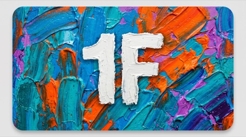

```
   __    _____
  /_ |  |  ___|
   | |  | |__
   | |  |  __|
   | |  | |
   |_|  |_|
```

# First Friday

In many cities the first Friday of every month is gallery night: art venues stay open late and people walk between them. Sometimes there is music.

This is not a monthly fun art event. It is a BYO art-gallery-and-music app for Apple TV, Mac, and Android.


## Installation

Download the source code, compile it, and install it on your own Apple TV from Xcode. (Or just vibe code your own equivalent.  This whole app was maybe 2 hours of work.) Pain in the butt, huh?  Apple needs to allow for more ad-hoc distribution of apps.

The Android project is in [`android/`](android/). Open that directory in Android Studio, or run `cd android && ./gradlew assembleDebug`. On first launch, enter a WebDAV URL and optional credentials.

## Setup

The purpose of the app is to display your own collection of artwork, from a WebDAV server.  It bundles a small number of paintings if you want to try out the app without one.

On my home network, I host a collection of images sourced from Wikiart on a Raspberry Pi. It is not hard to set up, and for those that do not want to host their own artwork collections, there are plenty of other art gallery apps in the Apple TV app store.

The app supports playing no music at all, of course.  It also offers some internet radio stations that I happen to like as pre-sets, and lets you put in your own radio station URL.

## Controls

During the slideshow:

- **Left / Right** — previous / next image
- **Up or Select (click the clickpad)** — show artwork/music controls, with Settings focused
- **Down** — open Settings directly, including while artwork is loading or unavailable
- **Back/Menu during the slideshow** — show controls
- **Left / Right in controls** — move focus between Resume Slideshow, music, and Settings; Select activates the focused button
- **Back/Menu in controls** — resume the slideshow

Controls remain visible until dismissed. Up/Down can be clickpad directional presses or directional swipes recognized by tvOS; no touch-only swipe is required. Closing Settings restores slideshow focus and the artwork timer.

On Android:

- **Tap the left third** — move back through viewing history
- **Tap the center third** — show or hide the painting metadata, now-playing information, and play/pause control for five seconds
- **Tap the right third** — move forward to another random image
- **Swipe left** — move forward to another random image
- **Swipe right** — move back through viewing history
- **Long press** — open settings for WebDAV, music, station, custom stream URL, and artwork duration
- Artwork defaults to seven minutes and can be set from 30 seconds to 30 minutes; the screen stays awake while the app is open

Artwork metadata comes from a YAML sidecar beside each image: `painting.jpg.yaml` for `painting.jpg`. Apple TV, Android, and the Mac version embedded in Viewport display `title`, `artist`, `date` (or `year`), `style`, and `genre`. Empty fields are omitted. Sidecars load on demand without delaying the artwork or scanning the entire metadata library; missing or invalid metadata falls back to the image path. Existing cached image indexes work without a rescan.

```yaml
title: "The Ghent Altar (detail)"
artist: "Jan van Eyck"
year: 1432
style: "Northern Renaissance"
genre: "religious painting"
```

The Mac implementation lives in the separate `viewport` project. All versions select artwork using an image-extension allowlist, so `.yaml` and `.yml` files are never slideshow candidates.

Metadata and WebDAV regression tests run with `swift test` at this project's root and in `viewport`, and with `cd android && ./gradlew testDebugUnitTest`. The listing tests mix images, sidecars, and other files in nested directories.

## Built-in Stuff

- Leonardo da Vinci, Mona Lisa, c. 1503–1519.- 
- Sandro Botticelli, The Birth of Venus, c. 1484–1486.
- Johannes Vermeer, Girl with a Pearl Earring, c. 1665.
- Katsushika Hokusai, The Great Wave off Kanagawa, c. 1831.
- Vincent van Gogh, The Starry Night, 1889.
- Gustav Klimt, The Kiss, 1907–1908.  


- WFMU , Freeform, Jersey City
- KEXP, Seattle public radio, music-focused 
- KCRW, Santa Monica public radio (eclectic / news)
- WPRB, Princeton college radio
- WETA Classical, DC classical
- Radio 1190, CU Boulder college radio
- NTS Radio 1 / 2, London, two live channels
- BBC World Service, International news/talk 
- BBC Radio 1, UK pop
- BBC Radio 2, UK adult contemporary
- BBC Radio 3, UK classical & jazz
- BBC Radio 4, UK news, drama, comedy
